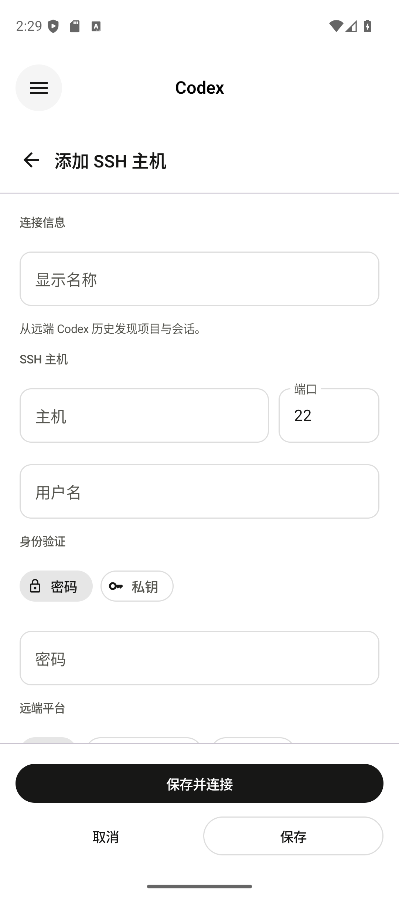
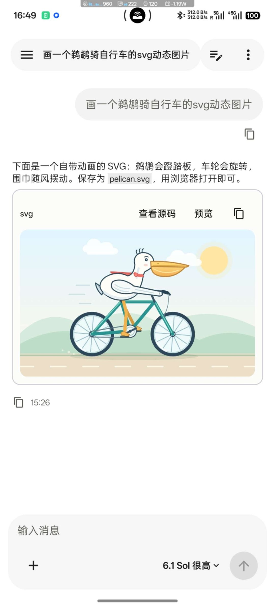
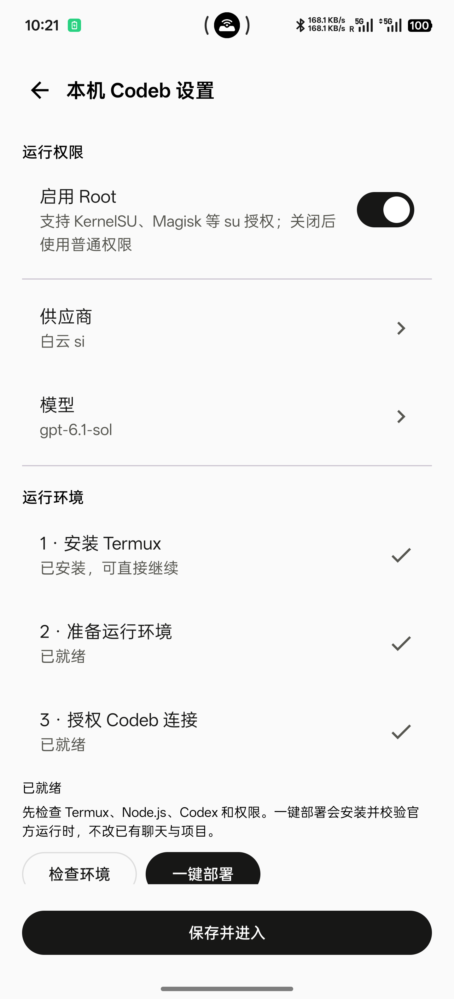
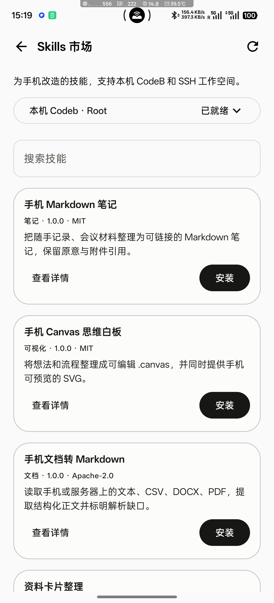

# 白云Codeb · Codeb for Android


日常模式直接使用兼容 OpenAI 的 API；本机 Codeb 通过 Termux 在手机上运行官方 Codex，也可通过 SSH 使用服务器上的 Codex。
原生 Android / Kotlin / Jetpack Compose，支持中文、English、日本語。

[最新版本及历史包](https://pan.quadk.cn/s/90c82ccf7344) · [官网](https://codeb.baiyun.si/) · [Skills 市场](https://codeb.baiyun.si/skills/) · [配置教程](https://api.baiyun.si/docs/codeb/) · [功能与限制](docs/LOCAL_CLIENT.md)

当前源码版本为 **0.2.17（versionCode 21）**。本机运行时的可运行检查见 `node tools/check-local-runtime.cjs`。

官网下载和应用内更新已同步至 **0.2.29（versionCode 33）**，主包约4.7MB；优化远程连接和重连，历史会话在连接后继续加载。公开源码和既有主程序 GitHub Release 仍为 0.2.17。

## 问题反馈与数据

设置中的“反馈问题”可填写描述、查看诊断信息并发送到云端，成功后获得反馈编号。诊断只附带应用版本、设备信息和近期错误，不读取聊天、工作文件或密钥。

基础安装与活跃统计默认开启，只使用随机安装标识、设备型号、系统和应用版本及最近活跃时间；保留旧版明确关闭过的选择。错误记录保存在手机本地，确认反馈后才上传。

## 固定下载与历史版本

[主程序、历史版本和本机环境包](https://pan.quadk.cn/s/90c82ccf7344) · [原夸克备用地址](https://pan.quark.cn/s/90c82ccf7344)

这是永久公开分享，无提取码。`pan.quadk.cn` 是用户指定的第三方分享入口，原夸克地址作为备用。分享内固定维护两个文件夹，后续版本继续追加，沿用同一分享链接：

| 文件夹 | 下载内容 |
| --- | --- |
| CodeB 主程序（含历史版本） | 约 4.7MB 的主 APK，按文件名中的版本号选择最新版本；保留已归档历史包。 |
| 本机环境包 | ARM64 环境 APK，约 184.4MiB（193MB），包含 Codex、Shell、Node.js、Python、Git；另有对应源码、说明和校验材料。 |

只使用远程 Codex 时安装主程序即可。使用本机 Codex，可以选择本机环境包或 Termux；两种环境分别保留会话和工作空间。

支持本机环境包的主程序（0.2.25 起）有两种获取方式：软件内官网/GitHub 下载后自动识别校验；从夸克或其他位置下载后，在“本机 Codeb 设置”点击“选择本地环境包”，选中环境 APK。校验后需经 Android 系统安装确认；环境没有单独操作界面。普通使用无需下载 `sources` 源码包。

环境包也可直接拉取：[官网 APK](https://codeb.baiyun.si/downloads/runtime/Codeb-runtime-arm64-0.162.0-r1.apk) · [GitHub APK/清单/源码材料](https://github.com/touensan/Codeb/releases/tag/runtime-arm64-0.162.0-r1)。主程序与环境包独立更新。

0.2.27 起的成品主程序优先读取可见界面树，并按元素点击、输入、滚动；支持最多 5 步有检查的操作，页面变化或动作失败会停止并报告完成数。截图只在界面树不足时按需使用；游戏或部分网页仍可能需要图片。界面信息及截图发送到用户选择的模型供应商，需先在软件中开启手机操控。

普通权限只列出系统允许看到的应用包名。已授权的本机 Root 工作进程可用 `/system/bin/cmd package list packages` 或 `pm list packages` 获取实际包名；环境包本身不会授予 Root。Root 和普通权限保持实际身份，不自动提权。

ADB 入口只打开开发者选项：USB 调试确认、无线调试配对由用户完成，当前没有内置 ADB 客户端或自动配对能力。[Android 官方 ADB 授权说明](https://developer.android.com/tools/adb#wireless-android11-command-line)。Root 不替代无障碍授权。


[](https://github.com/touensan/Codeb/actions/workflows/android.yml)
[](LICENSE)

## 界面预览

| SSH 远程连接 | API 对话与 SVG 预览 |
| :---: | :---: |
| <a href="assets/screenshots/ssh-connection.png"></a> | <a href="assets/screenshots/api-svg-preview.jpg"></a> |

| 本机 Codex 设置 | 手机 Skills 市场 |
| :---: | :---: |
| <a href="assets/screenshots/local-codeb-setup.png"></a> | <a href="assets/screenshots/skills-market.png"></a> |

点击图片可查看原图。连接页为模拟器截图，其余为一加 13 真机截图；图片记录不同开发阶段，界面以当前安装版本为准。

## 可以做什么

- **远程 Codex**：保存多个 SSH 连接，切换已有项目，继续服务器会话，查看历史、活动、命令与文件变更；模型、推理强度及速度选项跟随服务器实际能力。
- **手机直连 API**：Chat Completions / Responses 流式对话；管理多个供应商，拉取、搜索和分页查看模型，逐个测试模型，自动匹配推理档位，也能填写供应商自定义的原始 ID。运行中可切换模型、推理强度和供应商，后续消息或立即引导使用新选择。
- **本机 Codeb**：侧栏进入，设置保存供应商、模型与 Root 开关；按步骤下载 Termux、复制准备命令、检查环境，自有域名提供官方安装包与经校验的运行时。官方 Codex 处理本机文件和命令，复用已有 Responses 中转站。两档权限分别保存会话和默认项目目录，保留已有聊天配置。[本机配置说明](docs/PHONE_WORKSPACE.md)
- **阅读与文件**：目录浏览、自动折行的文本编辑、冲突保护、新建/重命名/删除与导入导出；Markdown、源码、图片和 PDF 预览，宽表格横向滑动，ZIP/APK/JAR 目录预览。
- **手机操控与 Skill**：工作模式支持 Codex 原生 Skill；Android 11+ 可通过无障碍读取屏幕、点击、滑动和输入。首次启用所选模型才测试图片输入，通过后放行，悬浮球可暂停/继续、查看输出和返回对话，也可随时停止授权。
- **Skills 市场**：浏览、搜索手机适配技能，选择本机或 SSH 环境安装、更新和卸载；保留来源/许可证，校验正文摘要，保护已有技能和本地修改。[浏览市场](https://codeb.baiyun.si/skills/)。
- **本地保存**：聊天、草稿和已读取的远程历史保存在手机；手动清理缓存保留工作空间、主机和 API 配置。
- **语言切换**：打开侧栏 → 设置 → 显示语言，可选择跟随系统、中文、English、日本語，立即生效并保存选择。
- **明暗外观**：打开侧栏 → 设置 → 外观，可选择跟随系统、明亮或暗黑，立即生效并保存选择；文字、图标、文件编辑器、Markdown、公式和代码差异随主题适配。
- **关于与更新**：显示实际安装版本、检查更新、打开配置教程与反馈交流群；添加 API 时可查看推荐供应商和兼容性说明，客户端离线保留有效配置缓存。

远程连接只需 SSH 和服务器上原装的官方 Codex，不要求安装第三方桥接、Hub、包装器或额外常驻服务。
手机直连 API 时无需服务器，聊天内容直接发送到用户配置的供应商。

## 安装与升级

官网下载正式安装包为 [0.2.28](https://codeb.baiyun.si/downloads/codeb-0.2.28.apk)，约 4.7MB，可用同路径的 [.sha256](https://codeb.baiyun.si/downloads/codeb-0.2.28.apk.sha256) 校验，应用内检查更新同步提供升级。[GitHub 既有主程序 Release](https://github.com/touensan/Codeb/releases/latest) 仍为 0.2.17 历史包，最新包请使用官网或固定分享。Android 8.0 及以上；本机环境包需要 ARM64 Android，也可选择 Termux。
正式包关闭调试模式和调试 API，不带 `dev` 版本后缀。

为让已有白云Codeb 用户覆盖升级并保留聊天、SSH 和 API 配置，正式版沿用原安装包名
`com.codex.remote.dev` 及同一签名身份；包名中的历史后缀不代表构建仍是开发版。
请直接覆盖安装，不要先卸载。原上游 `com.codex.remote` 应用保持独立。

桌面图标使用原生自适应图标：透明的太阳/紫云/闪电前景，白色底板由系统裁为圆形或圆角方形。
主体占比约八成，避免普通透明图标被厂商桌面再缩小一层。

## 连接服务器

服务器需要 OpenSSH、可用的官方 `codex` 命令和已完成的 Codex 认证。
支持密码或 PEM/OpenSSH 私钥。首次连接必须核对 SSH 主机指纹，指纹变化时阻止自动连接。
官方账号授权、API 中转配置与 Linux 安装步骤见[配置教程](https://api.baiyun.si/docs/codeb/)。

远程功能受服务器 Codex 版本、认证与协议能力影响。支持官方共享进程的服务器会优先连接 `app-server daemon`，同步运行中会话并提供引导和自动排队。
独立旧 CLI 的写入锁不会被强行破坏；同步期间自动重试，释放后恢复可写。模型出现在目录中不代表所有接口或推理档位都可用，建议逐项测试。
Responses 压缩需要上游支持相应端点；Chat Completions 没有通用原生压缩。

## 本地构建

APP 源码按 [Apache-2.0](LICENSE) 开源，可自行编译安装，使用远程 Codex、日常 API 对话和本机工作等功能。

需要 JDK 17、Android SDK 35：

```sh
./gradlew :app:testDebugUnitTest :app:lintDebug :app:assembleDebug
./gradlew :app:connectedDebugAndroidTest
```

本地调试包使用 `com.codex.remote.dev.debug`，与正式版分开。真实 SSH/收费 API 检查默认不运行。
签署正式包时，在仓库外管理私有 keystore，设置以下环境变量后运行 `./gradlew :app:assembleRelease`：

```text
CODEX_REMOTE_KEYSTORE_PATH
CODEX_REMOTE_KEYSTORE_PASSWORD
CODEX_REMOTE_KEY_ALIAS
CODEX_REMOTE_KEY_PASSWORD
```

自己构建的签名与官方不同，不能覆盖官方安装；不要通过卸载来规避签名错误而丢失数据。

## 来源与许可证

本项目基于 [Codex Remote for Android](https://github.com/liuhao-labs/codex-remote-android)，
保留上游 Git 历史及 [Apache-2.0 许可证](LICENSE)。历史上游标签不代表白云Codeb 的当前功能。
这是社区客户端，与 OpenAI 无隶属或官方背书关系；Codex 和 OpenAI 商标归其各自权利人所有。

## 社区

友情链接：[LINUX DO](https://linux.do/)

Codeb is an open-source native Android client for remote Codex over SSH, on-device Codex through Termux,
and OpenAI-compatible API conversations. You can build and install the app yourself.
